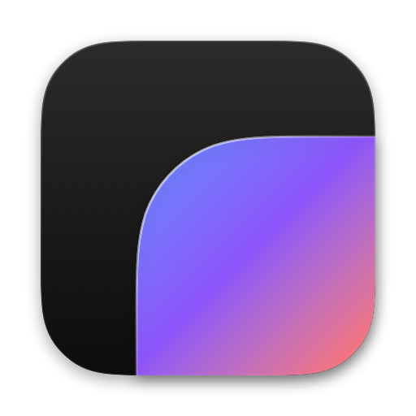
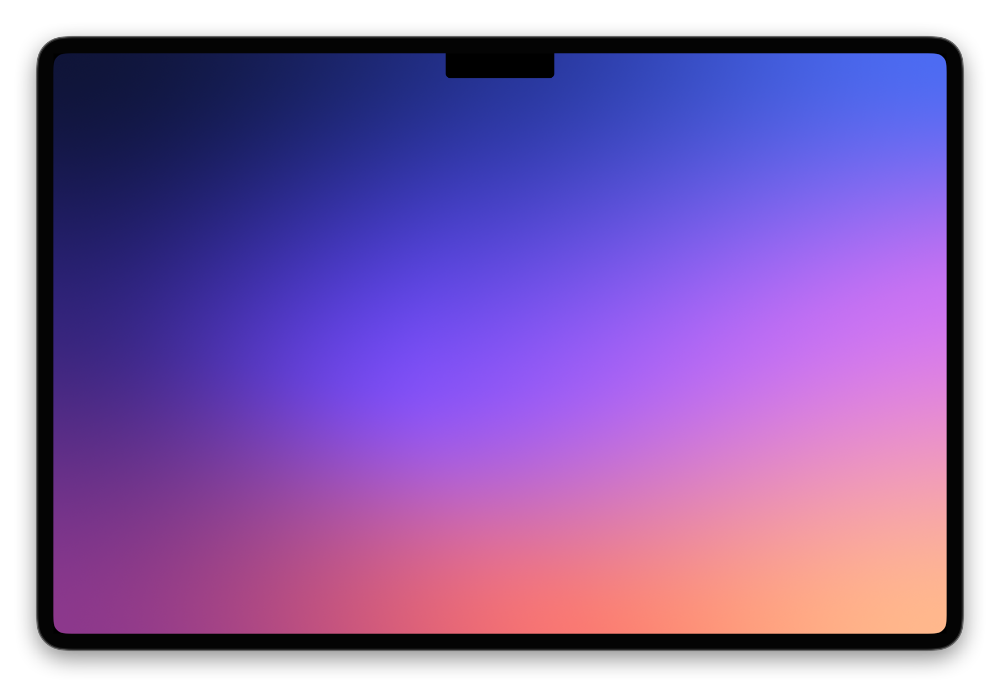
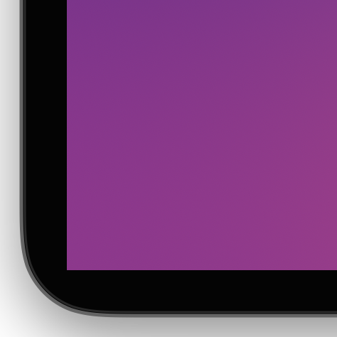
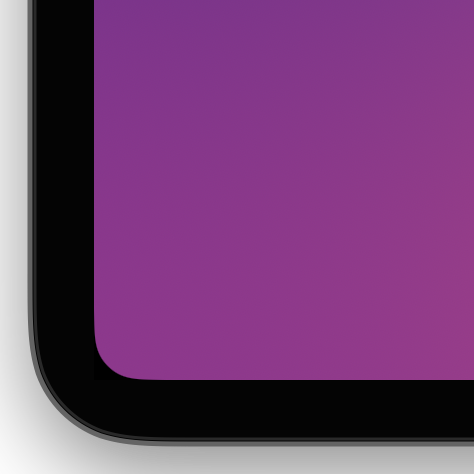
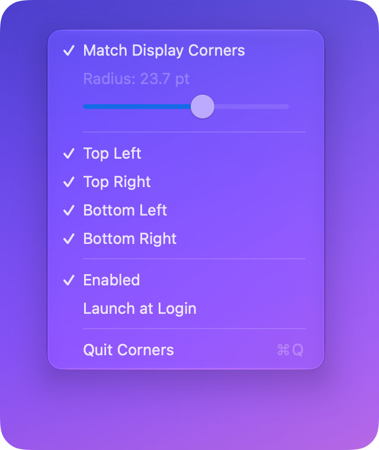

<p align="center">
  
</p>

<h1 align="center">Corners</h1>

<p align="center">
  Rounded corners for your Mac's display, matched to the hardware.<br>
  <sub>macOS 14+ · Swift & AppKit · no dependencies · MIT</sub>
</p>

<p align="center">
  
</p>

A MacBook's screen is rounded at the top and square at the bottom. Corners
rounds the bottom too, with the same radius and the same curve as the panel, so
the display reads as one clean shape, like the new OLED MacBook Pro.

It sits in the menu bar, uses about 12 MB of memory and does nothing at all
while you work.

<table>
  <tr>
    <th>Before</th>
    <th>After</th>
  </tr>
  <tr>
    <td></td>
    <td></td>
  </tr>
</table>

## Install

```sh
git clone https://github.com/subils/Corners.git
cd Corners
./build.sh --install
```

That builds the app, signs it locally for your Mac, copies it to
`/Applications` and opens it. You need macOS 14 or later and Xcode or the
Command Line Tools (`xcode-select --install`). Because the app is built on your
own machine, Gatekeeper doesn't get in the way.

On its first run, Corners turns on Launch at Login, so it's back after every
restart. You can switch that off from the menu.

## Using it



Click the icon in the menu bar.

**Match Display Corners** is on by default. Each screen gets the exact radius of
its own hardware corners, and an external monitor borrows the built-in panel's,
so everything matches.

**Radius** lets you pick your own value, from 0 to 40 pt. Moving the slider
switches matching off.

**Top Left**, **Top Right**, **Bottom Left** and **Bottom Right** turn
individual corners on and off.

**Enabled** hides everything without quitting.

Settings are saved and survive restarts.

<br clear="right">

## How it works

**The radius comes from the hardware.** macOS's window server keeps a record of
each panel's physical corner radius (`SLSDisplayGetCornerRadii`). On a 13-inch
MacBook Air with M3 that's 35.44 physical pixels, which is 23.7 pt at the
default scaled resolution and 17.7 pt at 1280×832. Corners reads it again
whenever the resolution changes, so the curve always lines up with the glass.

**The curve is Apple's, not an approximation.** Apple's corners aren't circular
arcs. They use a continuous curve that eases into the straight edge (the
"squircle"). Corners doesn't redraw that shape itself: it asks Core Animation
for it (`cornerCurve = .continuous`). It draws a screen-sized layer with a thick
black border whose inner edge is the rounded outline, and the window server's
GPU renderer does the rest. I checked the result pixel by pixel against Apple's
own rendering at the hardware radius, and they match.

**Four tiny windows, not one big one.** The obvious design is one transparent,
click-through window over the whole screen. That turns out to be expensive: the
cursor is always over it, and the window server wakes the app on every mouse
move. In 30 seconds of normal use that was about 3,300 wakeups. Corners uses
one small window per corner instead, just big enough for the curve, and wakes
about 30 times in the same 30 seconds.

**It stays put when you switch Spaces.** Windows that appear on every Space
still belong to a Space, so they slide away during the three-finger swipe and
pop back afterwards. Corners puts its windows in a dedicated layer above all
Spaces, the way the menu bar and the Dock work, so the corners never move.

**Screenshots don't see it.** The windows are excluded from screenshots and
screen sharing, the same as the real corners of the glass.

## Performance

Measured on a MacBook Air (M3) running macOS 27.

| | |
|---|---|
| Memory | ~12 MB |
| CPU while idle | 0.0 % |
| Wakeups while idle | none: no timers, no polling, no redraws |
| App size | 0.1 MB without the icon |
| Code | ~290 lines of Swift |

The corner layers are touched only when you change a setting or when the
displays change, such as a monitor plugged in or a new resolution. Those
changes are debounced to 200 ms.

## Uninstall

Turn off **Launch at Login** in the menu and quit Corners, then:

```sh
rm -rf /Applications/Corners.app
defaults delete local.corners
```

## Notes

Corners uses a couple of private macOS window-server functions: one for the
panel's corner radius and one for the layer above Spaces. Both are looked up at
runtime. If a future macOS drops one of them, Corners falls back quietly: to
the manual radius, or to ordinary all-Spaces windows. It never crashes over it.
The same private calls are why it can't go on the Mac App Store.

## License

MIT. See [LICENSE](LICENSE).

Made by [Genís Subils](https://gsubils.com).
